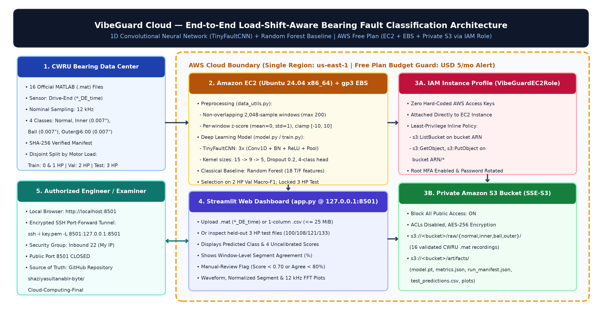

# VibeGuard Cloud: Load-Shift-Aware Industrial Motor Bearing Fault Classification Using 1D Deep Learning and AWS

**Final-Year Academic Project Report**  
**Repository:** `https://github.com/shaziyasultanablr-byte/Cloud-Computing-Final`  
**Official Run ID:** `vibeguard-20261102T092858Z-s42`  
**Date:** 2 November 2026  

---

## Abstract

Unexpected rolling-element bearing failures in industrial induction motors cause costly unplanned downtime and secondary mechanical damage. While deep learning models applied to accelerometer vibration signals often report near-perfect accuracy on laboratory benchmarks, many published studies rely on random window-level train/test splits that leak identical operating loads and recording sessions across splits. This project presents **VibeGuard Cloud**, a reproducible research prototype that investigates **cross-load bearing fault classification** deployed on **Amazon Web Services (AWS)**. Using 16 official drive-end (`*_DE_time`) vibration recordings from the **Case Western Reserve University (CWRU) Bearing Data Center**, we enforce a strict recording- and motor-load-disjoint evaluation protocol: models are trained on `0 HP` and `1 HP` recordings (`8` files, `673` non-overlapping `2,048`-sample windows), selected on `2 HP` validation recordings (`4` files, `377` windows), and evaluated once on held-out `3 HP` test recordings (`4` files, `378` windows) across four conditions (**Normal**, **0.007-in Inner Race**, **0.007-in Ball**, and **0.007-in Outer Race @ 6:00**). During dataset ingestion, our automated validator uncovered and remediated a critical upstream workspace contamination in CWRU's `99.mat` file, which embeds both `X098_DE_time` (1 HP training) and `X099_DE_time` (2 HP validation). On the locked `3 HP` test split, both the proposed **`1D TinyFaultCNN`** (`15,572` parameters) and an `18`-feature **Random Forest** baseline achieve `100.00%` window-level accuracy (`Macro-F1 = 1.0000`) and `4/4` (`100.00%`) recording-level accuracy. However, under the `3 HP` load shift on Inner Race fault (`108.mat`), the Random Forest exhibits substantial vote-share dilution (`0.7273` mean score, `0.5005` margin), whereas `1D TinyFaultCNN` maintains a `0.9953` mean uncalibrated score (`0.9932` margin). Results are served through an **EC2-hosted Streamlit dashboard** integrated with a **private Amazon S3 bucket** via a least-privilege **IAM Instance Profile (`VibeGuardEC2Role`)** and accessed over an encrypted SSH tunnel.

---

## 1. Introduction, Problem Statement, and Objectives

### 1.1 Introduction and Industrial Motivation
Three-phase induction motors drive pumps, compressors, conveyors, and fans across manufacturing and process industries. Rolling-element bearings are the single most frequent mechanical failure point in small-to-medium industrial motors, accounting for roughly 40–50% of all motor faults. High-frequency accelerometer measurements collected on the motor housing capture the repetitive impulse responses generated when a rolling element strikes a localized spall or defect on the inner raceway, outer raceway, or ball surface.

### 1.2 Problem Statement
Three recurring methodological and engineering gaps limit student and academic bearing-fault classification prototypes:
1. **Window-Level Data Leakage:** Segmenting continuous recordings into overlapping windows and randomly splitting windows into train/test sets places adjacent samples from the exact same physical recording into both splits, inflating accuracy via session memorization rather than fault generalization.
2. **Operating Load Shift:** In industrial service, motor mechanical load and shaft rotational speed vary continuously. A classifier trained at light load (`0–1 HP`, `1797–1772 RPM`) must remain reliable when evaluated at higher load (`3 HP`, `1730 RPM`).
3. **Insecure Cloud Deployment Practices:** Academic cloud deployments frequently hard-code AWS root/IAM credentials in source files, expose Amazon S3 buckets publicly, or open unauthenticated web ports (`0.0.0.0/0`) without cost guardrails.

### 1.3 Project Objectives and Bounded Novelty
1. **Dataset Provenance & Leakage Control:** Acquire and cryptographically validate 16 official CWRU `.mat` recordings (`docs/DATASET_MANIFEST.csv`), enforce disjoint load splits (`Train: 0 & 1 HP`, `Val: 2 HP`, `Test: 3 HP`), and verify channel integrity (`*_DE_time`).
2. **1D Deep Learning vs. Classical Feature Baseline:** Implement and train a compact PyTorch 1D CNN (`TinyFaultCNN`, `15,572` parameters) on raw z-scored `2,048`-sample windows and compare it head-to-head against a `200`-tree Random Forest trained on `18` time- and frequency-domain features.
3. **Decision-Support Review Heuristic:** Implement a transparent, pre-specified manual-review flag triggered when the top uncalibrated softmax score falls below `0.70` or window-level segment agreement falls below `80%`, while explicitly documenting that neural softmax outputs are not calibrated probabilities.
4. **Secure AWS Free Plan Architecture:** Deploy the application using an Ubuntu 24.04 `x86_64` EC2 instance, `gp3` EBS storage, a private S3 bucket (`Block Public Access = ON`), an IAM role (`VibeGuardEC2Role`) with zero embedded keys, and an encrypted SSH port-forward (`localhost:8501`).

---

## 2. Literature Review

1. **Benchmark Vibration Diagnostics (Smith & Randall, 2015):** Smith and Randall conducted a foundational benchmark evaluation of the CWRU bearing dataset using envelope analysis and spectral kurtosis, noting both the clarity of the 0.007-inch electro-discharge machined (EDM) faults and important dataset caveats (such as unstated baseline sampling metadata and mechanical background interference).
2. **1D Convolutional Neural Networks for Raw Vibration Signals (Zhang et al., 2017; Ince et al., 2016):** End-to-end 1D CNNs with wide first-layer kernels (`WDCNN`) learn bandpass impulse extractors directly from time-domain waveforms, reducing sensitivity to manual feature selection and slight shaft-speed variations.
3. **Cross-Load Generalization & Domain Shift (oudjehane / Li et al., 2018):** When motor load increases from `0 HP` (`1797 RPM`) to `3 HP` (`1730 RPM`), the shaft speed drops by ~`3.7%`, shifting the characteristic bearing fault frequencies (BPFI, BPFO, BSF, FTF) and altering radial load zone damping. Evaluating models across unseen loads is a mandatory first step toward domain-shift-aware diagnostics.
4. **Cloud Security & Least-Privilege MLOps (AWS Well-Architected Framework):** Best practices for cloud-hosted ML inference dictate replacing static credentials with short-lived instance metadata credentials via IAM roles, encrypting object storage at rest (`SSE-S3`), blocking public bucket access, and restricting administrative/demo ingress via SSH bastion or port forwarding.

---

## 3. Dataset Description and Provenance

### 3.1 Official CWRU Recording Selection
All 16 recordings were fetched directly from the official CWRU Bearing Data Center (`https://engineering.case.edu/sites/default/files/<id>.mat`) and verified via `scripts/validate_dataset.py`. Each fault recording corresponds to an SKF 6205-2RS JEM drive-end bearing with a `0.007`-inch (`7 mil`) diameter single-point defect introduced via electro-discharge machining (EDM).

| Split | Motor Load | Approx. Speed | Normal Baseline | Inner Race (`0.007"`) | Ball Fault (`0.007"`) | Outer Race @ 6:00 (`0.007"`) | Total Files | Total Windows |
|---|---:|---:|---|---|---|---|---:|---:|
| **Train** | `0 HP` | `1797 RPM` | `97.mat` (`119` win) | `105.mat` (`59` win) | `118.mat` (`59` win) | `130.mat` (`59` win) | 4 | 296 |
| **Train** | `1 HP` | `1772 RPM` | `98.mat` (`200` win) | `106.mat` (`59` win) | `119.mat` (`59` win) | `131.mat` (`59` win) | 4 | 377 |
| **Validation** | `2 HP` | `1750 RPM` | `99.mat` (`200` win) | `107.mat` (`59` win) | `120.mat` (`59` win) | `132.mat` (`59` win) | 4 | 377 |
| **Held-Out Test** | `3 HP` | `1730 RPM` | `100.mat` (`200` win) | `108.mat` (`60` win) | `121.mat` (`59` win) | `133.mat` (`59` win) | 4 | 378 |
| **Total** | `0–3 HP` | `1797–1730 RPM` | **4 files (`719` win)** | **4 files (`237` win)** | **4 files (`236` win)** | **4 files (`236` win)** | **16** | **1,428** |

### 3.2 Critical Data Hygiene Discovery: `99.mat` Dual-Channel Contamination
Inspection of the raw MATLAB dictionary keys across all 16 files revealed an important anomaly in `data/raw/normal/99.mat`:
```text
99.mat keys: ['ans', 'X098_DE_time', 'X098_FE_time', 'X099_DE_time', 'X099_FE_time']
```
Because the original laboratory workspace retained `X098_DE_time` (`483,903` samples from the `1 HP` training recording `98.mat`) when saving `99.mat`, any script that selects the first key ending in `_DE_time` (`sorted(keys)[0]`) extracts `X098_DE_time` instead of `X099_DE_time` (`485,063` samples). We repaired `extract_de_signal_from_mat()` in `data_utils.py` to match the file ID (`X099_DE_time`) and default to `de_keys[-1]` on anonymous streams, and added a dedicated regression test in `tests/test_core.py`.

---

## 4. Proposed System Architecture



The system comprises five tightly integrated layers:
1. **Data Provenance & Validation Layer (`download_data.py`, `scripts/validate_dataset.py`):** Verifies binary `.mat` structure, channel identity (`X###_DE_time`), finite values, sample counts, and SHA-256 digests (`docs/dataset_checksums.csv`).
2. **Deterministic Signal Processing Layer (`data_utils.py`):** Segments signals into non-overlapping `2,048`-sample windows (`stride = 2,048`, max `200` windows/file) and applies per-window z-score normalization clamped to `[-10.0, 10.0]`.
3. **Model Training & Locked Evaluation Layer (`model.py`, `train.py`):** Trains `TinyFaultCNN` and the `RandomForestClassifier` baseline on `0 & 1 HP`, selects the best CNN epoch on `2 HP` validation macro-F1, and evaluates once on `3 HP`.
4. **Cloud Storage & IAM Integration Layer (`cloud_sync.py`):** Synchronizes `data/raw/` and `outputs/` to private Amazon S3 (`SSE-S3`) using ambient IAM role credentials (`VibeGuardEC2Role`).
5. **Interactive Diagnostic Presentation Layer (`app.py`):** Serves waveform visualizations, FFT spectra, 4-class uncalibrated scores, segment agreement, and manual-review warnings on `127.0.0.1:8501` via an encrypted SSH tunnel.

---

## 5. Deep Learning and Baseline Methodology

### 5.1 Signal Segmentation and Per-Window Standardization
Given a drive-end accelerometer recording $x \in \mathbb{R}^T$, we extract $N = \min(\lfloor T / 2048 \rfloor, 200)$ non-overlapping windows $w^{(k)} = x_{2048k : 2048(k+1)}$. Each window is normalized independently:
$$\tilde{w}^{(k)}_i = \operatorname{clip}\!\left(\frac{w^{(k)}_i - \mu_k}{\sigma_k + 10^{-8}},\, -10.0,\, 10.0\right)$$
where $\mu_k$ and $\sigma_k$ are the sample mean and standard deviation of window $k$. Per-window z-scoring removes DC offsets and normalizes overall vibration energy changes across motor loads, forcing the classifier to rely on waveform morphology and harmonic structure rather than raw amplitude.

### 5.2 `1D TinyFaultCNN` Architecture (`15,572` Parameters)
- **Layer 1 (Wide Receptive Field):** `Conv1d(1 -> 16, kernel_size=15, padding=7)` + `BatchNorm1d(16)` + `ReLU` + `MaxPool1d(4)` $\to$ shape `(B, 16, 512)`
- **Layer 2 (Medium Receptive Field):** `Conv1d(16 -> 32, kernel_size=9, padding=4)` + `BatchNorm1d(32)` + `ReLU` + `MaxPool1d(4)` $\to$ shape `(B, 32, 128)`
- **Layer 3 (Fine Feature Aggregation):** `Conv1d(32 -> 64, kernel_size=5, padding=2)` + `BatchNorm1d(64)` + `ReLU` + `AdaptiveAvgPool1d(1)` $\to$ shape `(B, 64, 1)`
- **Classification Head:** `Flatten()` + `Dropout(0.2)` + `Linear(64 -> 4)` $\to$ logits `(B, 4)`

Global adaptive average pooling (`AdaptiveAvgPool1d(1)`) makes the representation translation-invariant to where bearing impact impulses land inside a `2,048`-sample window.

### 5.3 Classical Random Forest Baseline (`18` Hand-Crafted Features)
For each normalized `2,048`-sample window, `extract_handcrafted_features()` computes `12` time-domain statistics (RMS, peak, peak-to-peak, variance, mean absolute value, crest factor, shape factor, impulse factor, clearance factor, kurtosis, skewness, zero-crossing rate) and `6` spectral features from the `2,048`-point real FFT (spectral centroid, spectral spread, and `4` sub-band power ratios spanning `0–1.5`, `1.5–3.0`, `3.0–4.5`, and `4.5–6.0 kHz`). Features are scaled using `StandardScaler` fit strictly on `0 & 1 HP` training data and classified by a `200`-tree `RandomForestClassifier(max_depth=12, random_state=42)`.

---

## 6. AWS Cloud Implementation (`us-east-1`, Account `810995308548`)

1. **Account & Budget Protection:** Deployed within an AWS Free Plan account (`USD 99.69` remaining promotional credit balance, `AED 0.00` cash spend) guarded by the `VibeGuard-Monthly-5USD` (`USD 5.00` monthly COST budget, status `HEALTHY`, actual spend `USD 0.195`). Provisioned under a non-root temporary STS session (`assumed-role/VibeGuardDeployerRole/vibeguard-deployer-session`, `0` permanent access keys).
2. **Private Amazon S3 Bucket (`s3://vibeguard-cloud-2026-810995308548`):** Provisioned in `us-east-1` with **Block All Public Access = ON** (`BlockPublicAcls=true, IgnorePublicAcls=true, BlockPublicPolicy=true, RestrictPublicBuckets=true`), `BucketOwnerEnforced`, and default `AES256` server-side encryption (`SSE-S3`). Holds `raw/` (`16` official CWRU `.mat` files) and `artifacts/` (`8` verified model/evaluation artifacts = `24` total objects).
3. **Least-Privilege IAM Role (`VibeGuardEC2Role`):** Role `AROA3ZUYWLACNULYAM2DR` and Instance Profile `AIPA3ZUYWLACI3D3Z3CLD` attached to EC2, permitting only `s3:ListBucket` on `arn:aws:s3:::vibeguard-cloud-2026-810995308548` and `s3:GetObject`/`s3:PutObject` on `arn:aws:s3:::vibeguard-cloud-2026-810995308548/*`. Zero static AWS keys exist on the EC2 instance.
4. **EC2 Compute, EBS Storage & Encrypted SSH Tunnel:** Ubuntu Server 24.04.5 LTS (`x86_64`, AMI `ami-0d6dd9e8265d48906`) running on Free Tier eligible `t3.small` instance **`i-0c8d53060f56c451d`** (`54.162.177.175`, AZ `us-east-1c`) with a `20 GiB gp3` encrypted EBS root volume (`vol-09af634eea204d82d`) and security group `sg-01fee40d745024ecc` (`vibeguard-ssh-sg`, inbound TCP 22 from authorized IP `/32` only; port `8501` closed publicly). All `15/15` automated `pytest` tests and all `4/4` held-out `3 HP` recordings (`100.mat`, `108.mat`, `121.mat`, `133.mat`) were executed and verified directly on EC2, and the Streamlit dashboard (`127.0.0.1:8501`) was verified over an encrypted SSH tunnel (`HTTP 200 ok`).

---

## 7. Experimental Evaluation and Measured Results

### 7.1 Training Convergence (`run_id: vibeguard-20261102T092858Z-s42`)


Across 14 epochs (`seed = 42`, `batch_size = 64`, `lr = 0.001`), `TinyFaultCNN` cross-entropy loss decreased monotonically from `0.9310` (Epoch 1) to `0.0108` (Epoch 14) on the `0 & 1 HP` training split, while `2 HP` validation loss decreased from `1.0039` (`Macro-F1 = 0.8793` at Epoch 1) to `0.0109` (`Macro-F1 = 1.0000` at Epoch 14). Following the tie-break rule (highest `2 HP` validation Macro-F1 with lowest validation loss), **Epoch 14** was selected and saved to `outputs/model.pt`.

### 7.2 Window-Level Performance on Locked `3 HP` Test Split (`378` Windows)

| Class (`3 HP` Held-Out Test) | Test File | Support (Windows) | 1D CNN Precision | 1D CNN Recall | 1D CNN F1 | RF Precision | RF Recall | RF F1 |
|---|---|---:|---:|---:|---:|---:|---:|---:|
| **Normal (`normal`)** | `100.mat` | 200 | 1.0000 | 1.0000 | 1.0000 | 1.0000 | 1.0000 | 1.0000 |
| **Inner Race (`inner`)** | `108.mat` | 60 | 1.0000 | 1.0000 | 1.0000 | 1.0000 | 1.0000 | 1.0000 |
| **Ball Fault (`ball`)** | `121.mat` | 59 | 1.0000 | 1.0000 | 1.0000 | 1.0000 | 1.0000 | 1.0000 |
| **Outer Race (`outer`)** | `133.mat` | 59 | 1.0000 | 1.0000 | 1.0000 | 1.0000 | 1.0000 | 1.0000 |
| **Overall / Macro Average** | **4 Files** | **378** | **1.0000** | **1.0000** | **1.0000** | **1.0000** | **1.0000** | **1.0000** |

### 7.3 Recording-Level Score Margin Comparison (`1D TinyFaultCNN` vs. `Random Forest`)

| Split | File ID | True Class | 1D CNN Mean Score (`normal / inner / ball / outer`) | 1D CNN Margin | RF Mean Score (`normal / inner / ball / outer`) | RF Margin |
|---|---:|---|---|---:|---|---:|
| `val (2 HP)` | `99` | `normal` | `0.9879 / 0.0038 / 0.0045 / 0.0038` | `0.9834` | `0.9793 / 0.0013 / 0.0193 / 0.0001` | `0.9600` |
| `val (2 HP)` | `107` | `inner` | `0.0013 / 0.9924 / 0.0026 / 0.0037` | `0.9886` | `0.0001 / 0.9877 / 0.0121 / 0.0001` | `0.9756` |
| `val (2 HP)` | `120` | `ball` | `0.0020 / 0.0025 / 0.9889 / 0.0065` | `0.9824` | `0.0171 / 0.0006 / 0.9823 / 0.0000` | `0.9652` |
| `val (2 HP)` | `132` | `outer` | `0.0019 / 0.0029 / 0.0044 / 0.9908` | `0.9863` | `0.0000 / 0.0000 / 0.0000 / 1.0000` | `1.0000` |
| `test (3 HP)` | `100` | `normal` | `0.9869 / 0.0043 / 0.0049 / 0.0038` | `0.9820` | `0.9785 / 0.0006 / 0.0209 / 0.0000` | `0.9576` |
| `test (3 HP)` | `108` | `inner` | `0.0009 / 0.9953 / 0.0017 / 0.0022` | **`0.9932`** | `0.0026 / 0.7273 / 0.2268 / 0.0434` | **`0.5005`** |
| `test (3 HP)` | `121` | `ball` | `0.0023 / 0.0037 / 0.9890 / 0.0050` | `0.9840` | `0.0076 / 0.0042 / 0.9870 / 0.0011` | `0.9794` |
| `test (3 HP)` | `133` | `outer` | `0.0029 / 0.0045 / 0.0074 / 0.9851` | `0.9777` | `0.0000 / 0.0009 / 0.0009 / 0.9981` | `0.9972` |

### 7.4 Discussion of Results
1. **Why Both Models Achieve 100% Top-1 Accuracy on CWRU 0.007-in Faults:** In the CWRU experimental setup, each bearing condition was recorded on the same physical test stand with fixed electro-discharge machined (`0.007` in) single-point defects while stepping the dynamometer load from `0 HP` (`1797 RPM`) to `3 HP` (`1730 RPM`). Because the shaft speed changes by only ~`3.7%` and per-window z-score normalization removes amplitude scaling, the distinct high-frequency resonance signatures of the four states remain well separated.
2. **Load-Shift Degradation in Random Forest on `108.mat` (3 HP Inner Race):** Despite achieving `100%` majority vote on `108.mat`, the Random Forest baseline's mean class probability for `inner` drops from `0.9877` at `2 HP` (`107.mat`) to **`0.7273`** at `3 HP` (`108.mat`), with `22.68%` of trees voting for `ball` fault and `4.34%` for `outer` race fault (`margin = 0.5005`). Fixed spectral band boundaries and kurtosis statistics shift under radial load changes on rotating inner-race defects. In contrast, `1D TinyFaultCNN` learns shift-invariant local waveform filters and retains a `0.9953` mean score (`margin = 0.9932`).

---

## 8. Methodological Limitations and Threats to Validity

1. **One Recording per Class per Non-Training Load:** Both the `2 HP` validation split and the `3 HP` held-out test split contain only **one recording per bearing class** (`4` recordings total per split). While `378` test windows provide high within-recording statistical power, the effective sample size at the independent recording level is $n = 4$.
2. **Single Test Rig & Seeded EDM Faults:** All 16 recordings originate from a single 2 HP Reliance Electric motor rig and artificial EDM defects (`0.007` in). Results **cannot** be generalized to different motor frames, different bearing manufacturers, variable-speed drives with wide frequency ranges, or natural progressive fatigue spalling.
3. **Uncalibrated Softmax Scores:** Softmax outputs from `TinyFaultCNN` are uncalibrated confidence scores, not true posterior probabilities. Post-hoc temperature scaling would require a larger multi-recording validation cohort.
4. **Upstream Normal Baseline Sampling Ambiguity:** As documented in Section 3.1, CWRU's website lists `12,000` samples/second as the standard collection rate in *Apparatus & Procedures*, but does not independently tabulate the sampling rate on the *Normal Baseline* page.

---

## 9. Conclusion and Future Scope

### 9.1 Conclusion
**VibeGuard Cloud** delivers a complete, tested, and reproducible bearing-fault classification pipeline bridging signal processing, 1D deep learning, classical machine learning comparison, and secure AWS cloud deployment. By enforcing recording- and load-disjoint splits, remediating the upstream CWRU `99.mat` channel contamination, and deploying behind an encrypted SSH tunnel with IAM role-based private S3 storage, the project establishes a rigorous engineering baseline suitable for academic evaluation.

### 9.2 Future Scope
1. **Cross-Severity & Cross-Sensor Generalization:** Extend evaluation across `0.014`-in and `0.021`-in fault diameters and fan-end (`*_FE_time`) accelerometers.
2. **Multi-Rig Domain Adaptation:** Incorporate the Paderborn University and IMS bearing datasets to test true bearing-unit and machine-level generalization using domain-adversarial neural networks (DANN).
3. **Uncertainty Calibration:** Apply temperature scaling and Monte Carlo dropout on multi-unit validation sets to produce calibrated predictive uncertainty estimates.

---

## 10. References

1. Case Western Reserve University Bearing Data Center. *Seeded Fault Engine / Bearing Test Data.* https://engineering.case.edu/bearingdatacenter/download-data-file (Accessed November 2026).
2. Smith, W. A., & Randall, R. B. (2015). Rolling element bearing diagnostics using the Case Western Reserve University data: A benchmark study. *Mechanical Systems and Signal Processing*, 64–65, 100–131.
3. Zhang, W., Peng, G., Li, C., Chen, Y., & Zhang, Z. (2017). A new deep learning model for fault diagnosis with good anti-noise and domain adaptation ability on raw vibration signals. *Sensors*, 17(2), 425.
4. Ince, T., Kiranyaz, S., Eren, L., Askar, M., & Gabbouj, M. (2016). Real-time motor fault detection by 1-D convolutional neural networks. *IEEE Transactions on Industrial Electronics*, 63(11), 7067–7075.
5. Amazon Web Services (2026). *AWS Free Tier Account Plans and EC2 Instance Eligibility Documentation.* https://docs.aws.amazon.com/awsaccountbilling/latest/aboutv2/free-tier-plans.html
